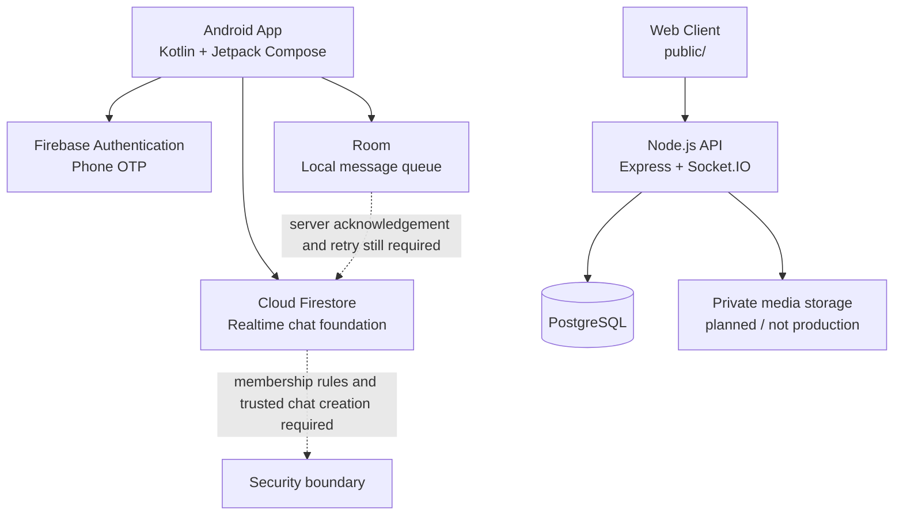
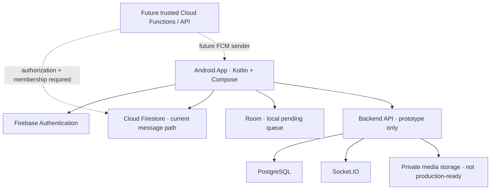

# Chatin — Android Messenger, Web Client & Realtime Backend

Chatin adalah aplikasi pesan Android dengan fondasi web client dan backend realtime.

<p align="center">
  <strong>Chatin • Android-first Messenger</strong><br/>
  <em>Clean interface · Firebase identity · Realtime foundation</em>
</p>

<p align="center">
  <a href="https://github.com/adebojel/Chatin/actions/workflows/android-debug-apk.yml"></a>
  <a href="https://github.com/adebojel/Chatin/pull/3"></a>
  
</p>

> **Tampilan dan screenshot:** repository saat ini belum menyimpan screenshot aplikasi yang diambil dari emulator/perangkat pada build tervalidasi. Gambar launcher bukan screenshot UI, sehingga tidak dipakai sebagai bukti tampilan. Screenshot layar masuk, inbox, percakapan, profil, serta tampilan tablet akan ditambahkan setelah pengambilan nyata dan pemeriksaan privasi. Jangan menganggap ilustrasi atau mockup sebagai tampilan aplikasi yang sudah berjalan.

## Gambaran arsitektur



Diagram menunjukkan komponen yang ada dan batas integrasi yang masih harus diselesaikan; bukan bukti bahwa semua jalur produksi sudah aktif.


**Status: BETA DEVELOPMENT — BELUM SIAP PRODUKSI.** Autentikasi OTP Firebase dan sebagian alur pesan telah diperkuat, tetapi pengujian perangkat nyata, sinkronisasi offline, aturan keamanan Firestore, panggilan WebRTC, notifikasi push, dan enkripsi end-to-end penuh belum selesai. Jangan gunakan untuk percakapan rahasia atau data produksi.

## Peringatan backend dan keamanan

Folder backend saat ini masih prototipe dan **tidak boleh dideploy ke produksi**. Startup `server.js` kini menolak `NODE_ENV=production` sampai audit keamanan ditutup. WebAuthn, otorisasi Socket.IO, pengelolaan pre-key, privasi upload media, penyatuan identitas Firebase/backend, dan E2EE belum memenuhi syarat produksi.

Baca [Audit Keamanan Backend](docs/BACKEND_SECURITY_AUDIT.md) sebelum menjalankan server. Jangan gunakan backend ini untuk data pengguna nyata.

## Pembaruan terbaru

| Informasi | Nilai |
| --- | --- |
| Versi Android | 1.0 (versionCode 1, sesuai konfigurasi Gradle saat ini) |
| Package ID | com.aistudio.chatin.kxqrvz |
| Minimum Android | Android 7.0 / API 24 |
| Target SDK | API 36 |
| Waktu pembaruan README | **16 November 2026** |
| Branch pengembangan | feat/chatin-core-reliability |
| Commit branch terbaru saat dokumentasi diperbarui | 187252673b797452601f808b505a2e88a88215c9 |
| Pull request | [PR #3 — Firebase phone verification & message reliability](https://github.com/adebojel/Chatin/pull/3) |

### Perubahan kode terbaru di branch pengembangan

- Login nomor telepon memakai Firebase Phone Authentication dan verifikasi OTP sungguhan; enam digit sembarang tidak lagi dianggap valid.
- Nomor telepon divalidasi dalam format internasional E.164 (contoh Indonesia: +6281234567890).
- Sesi Firebase menjadi sumber autentikasi; status login lokal saja tidak cukup.
- Logout mengakhiri sesi Firebase.
- Profil disimpan setelah autentikasi berhasil.
- Pesan memakai Firebase UID sebagai identitas pengirim.
- Pesan baru berstatus PENDING sampai Firestore mengonfirmasi penulisan.
- Ditambahkan unit test validator nomor telepon dan langkah unit test pada workflow Android.

**Catatan:** PR #3 masih draft dan belum digabung ke main. Perubahan tersebut ada pada branch PR, bukan berarti sudah tersedia pada versi rilis publik.

## Unduh dan instal aplikasi Android

### Build uji coba (APK Debug)

**[Unduh APK Debug terbaru — build dan unit test sukses (commit 9bdafd7)](https://github.com/adebojel/Chatin/actions/runs/43803067224)** — artifact `chatin-debug-apk` tersedia pada bagian Artifacts (masa simpan 7 hari).\n\n[Semua workflow build APK Chatin](https://github.com/adebojel/Chatin/actions/workflows/android-debug-apk.yml)  
**[Lihat detail build terbaru](https://github.com/adebojel/Chatin/actions/runs/43803067224)**

Cara mengambil APK setelah workflow selesai:

1. Buka tautan GitHub Actions di atas.
2. Pastikan status workflow completed dan hasilnya success.
3. Gulir ke bagian Artifacts pada halaman run.
4. Unduh artifact bernama chatin-debug-apk.
5. Ekstrak ZIP, lalu cari app-debug.apk.
6. Pindahkan APK ke ponsel Android dan buka file tersebut.
7. Jika Android meminta izin, izinkan instalasi dari sumber yang digunakan untuk membuka APK. Matikan kembali izin tersebut bila tidak diperlukan.
8. Jalankan Chatin dan ikuti checklist uji coba di bawah.

**Penting:**
- Tautan di atas adalah halaman workflow, bukan tautan APK langsung. APK baru dapat diunduh setelah build sukses dan artifact terunggah.
- Artifact debug CI disimpan selama 7 hari. Jika kedaluwarsa, jalankan ulang workflow dari tab Actions atau minta build baru.
- Build Debug ditujukan untuk pengujian, bukan distribusi publik.
- Belum ada tautan Google Play Store atau rilis stabil.
- Hanya instal APK dari repository resmi Chatin.

#
## GitHub Releases — APK bertanda tangan

**[Buka halaman unduhan Chatin — GitHub Releases](https://github.com/adebojel/Chatin/releases/latest)**. Tautan ini akan menampilkan APK pada bagian **Assets** setelah rilis pertama berhasil diterbitkan. Saat ini belum ada rilis yang dipublikasikan.

Workflow rilis resmi tersedia di [Build and publish signed Chatin APK](https://github.com/adebojel/Chatin/actions/workflows/build-apk.yml). Workflow ini dijalankan manual dan memerlukan konfigurasi repository secrets berikut oleh pemilik repository: `KEYSTORE_BASE64`, `KEYSTORE_PASSWORD`, `KEY_ALIAS`, dan `KEY_PASSWORD`. Jangan pernah memasukkan nilai secret ke README, commit, issue, atau chat.

Setelah secret tersedia, pemilik repository dapat menjalankan workflow dengan tag rilis unik (contoh beta), memeriksa unit test release, signature APK, SHA-256, lalu workflow akan mengunggah APK dan laporan signature ke GitHub Releases. **Saat ini belum ada GitHub Release APK yang dapat diunduh**; jangan menganggap artifact debug CI sebagai APK rilis bertanda tangan.

## Membuat APK sendiri melalui Android Studio

1. Pasang Android Studio dan Android SDK yang mendukung API 36.
2. Clone repository:
   ```bash
   git clone https://github.com/adebojel/Chatin.git
   cd Chatin
   ```
3. Checkout branch pengembangan bila ingin menguji perubahan terbaru:
   ```bash
   git checkout feat/chatin-core-reliability
   ```
4. Siapkan konfigurasi Firebase.
5. Buka folder proyek di Android Studio dan tunggu Gradle Sync.
6. Jalankan:
   ```bash
   ./gradlew :app:testDebugUnitTest
   ./gradlew :app:assembleDebug
   ```
7. APK dihasilkan di app/build/outputs/apk/debug/app-debug.apk.

Di Windows gunakan gradlew.bat sebagai pengganti ./gradlew.


## Tampilan aplikasi dan materi visual

> **Catatan transparansi:** repository saat ini berisi ikon launcher, tetapi belum berisi screenshot layar aplikasi yang diambil dari perangkat/emulator pada build tervalidasi. Ikon launcher bukan screenshot UI. Screenshot Inbox, percakapan, profil, panggilan, dan pengaturan akan ditambahkan setelah pengujian UI pada perangkat nyata agar README tidak menampilkan mockup atau gambar aplikasi lain seolah-olah Chatin.

### Arsitektur sistem (ringkasan)



Garis putus-putus menunjukkan komponen target yang belum selesai. Backend prototipe tidak boleh dipakai untuk data produksi.

### Dokumentasi engineering

- [Audit keamanan backend](docs/BACKEND_SECURITY_AUDIT.md)
- [Audit integrasi dan riset repository open-source](docs/OPEN_SOURCE_AUDIT.md)
- [Roadmap produk dan definisi selesai](docs/PRODUCT_ROADMAP.md)
- [Panduan konfigurasi Firebase](docs/FIREBASE_SETUP.md)

## Fitur dan status implementasi

| Area | Status saat ini | Catatan |
| --- | --- | --- |
| Android native | Fondasi tersedia | Kotlin, Jetpack Compose |
| Nomor telepon + OTP | Integrasi Firebase di PR #3 | Perlu konfigurasi project dan uji perangkat nyata |
| Validasi E.164 | Ditambahkan | Unit test tersedia |
| Sesi dan logout Firebase | Diperkuat di PR #3 | Perlu uji siklus hidup aplikasi |
| Profil pengguna | Integrasi Firestore tersedia | Skema ID pengguna masih perlu migrasi |
| Chat dan pesan Firestore | Implementasi dasar tersedia | Rules dan keanggotaan chat belum siap produksi |
| Status pending pesan | Diperbaiki di PR #3 | Tidak mengklaim terkirim sebelum acknowledgement |
| Cache lokal/offline | Fondasi lokal tersedia | Worker upload dan rekonsiliasi outbox belum selesai |
| Web client | Ada di folder public/ | Perlu pengujian integrasi |
| Backend realtime | Express + Socket.IO | Perlu konfigurasi deployment dan pengujian |
| PostgreSQL | Skema tersedia | Perlu konfigurasi dan migrasi server |
| Upload media | Belum siap | Provider dan akses privat perlu diselesaikan |
| Push notification FCM | Belum dikonfirmasi selesai | Jangan diasumsikan aktif |
| Voice/video call WebRTC | Belum selesai | UI/fondasi bukan panggilan produksi |
| Enkripsi end-to-end (E2EE) | Belum tersedia menyeluruh | Pesan saat ini dapat disimpan sebagai teks biasa |
| Keamanan Firestore produksi | Belum selesai | Perlu UID membership, rules ketat, dan emulator tests |

## Riset dan audit integrasi open-source

Daftar repository, snapshot lisensi, evaluasi kompatibilitas, dan keputusan integrasi dicatat di [docs/OPEN_SOURCE_AUDIT.md](docs/OPEN_SOURCE_AUDIT.md). Kandidat utama yang ditelaah:

- [LiveKit Android SDK](https://github.com/livekit/client-sdk-android) — kandidat POC audio/video realtime; belum diintegrasikan.
- [GetStream WebRTC Android](https://github.com/GetStream/webrtc-android) — alternatif stack WebRTC; belum diintegrasikan.
- [Firebase Android Quickstarts](https://github.com/firebase/quickstart-android) — pola resmi Auth, FCM, dan Firestore.
- [Whizzz-The-ChatApp](https://github.com/uditbhaskar/Whizzz-The-ChatApp) — referensi Clean Architecture/MVI dan Firebase.
- [Element X Android](https://github.com/element-hq/element-x-android) dan [Signal Android](https://github.com/signalapp/Signal-Android) — referensi arsitektur saja karena AGPL-3.0.

**Belum ada kode pihak ketiga yang disalin ke aplikasi.** Integrasi dilakukan selektif setelah pemeriksaan lisensi, dependency transitif, keamanan, ukuran APK, dan kompatibilitas. Repo AGPL, repo tanpa lisensi yang jelas, dan demo dengan backend palsu tidak digabungkan begitu saja.

## Arsitektur dan teknologi

- Android: Kotlin, Jetpack Compose, Coroutines/Flow, Room, Retrofit/OkHttp.
- Autentikasi dan database realtime: Firebase Authentication dan Cloud Firestore.
- Backend: Node.js, Express, Socket.IO, PostgreSQL, JWT, bcrypt.
- Web client: HTML, CSS, dan JavaScript pada folder public/.
- Media: rancangan integrasi penyimpanan kompatibel S3, misalnya Cloudflare R2.

### Struktur repository

| Path | Kegunaan |
| --- | --- |
| app/ | Aplikasi Android |
| app/src/main/java/ | Source Kotlin |
| app/src/test/ | Unit tests |
| public/ | Web client |
| server.js | Server Express dan Socket.IO |
| schema.sql | Skema PostgreSQL |
| gradle/libs.versions.toml | Katalog versi dependency Gradle |
| .env.example | Template variabel lingkungan backend |
| docs/FIREBASE_SETUP.md | Panduan Firebase dan catatan keamanan |
| .github/workflows/ | Workflow CI/build APK |

## Persyaratan pengembangan

- Android Studio yang mendukung Android Gradle Plugin dan SDK proyek.
- JDK 17 untuk workflow CI Android.
- Android SDK platform/build tools API 36.
- Node.js 18 atau versi yang didukung platform deployment.
- npm dan PostgreSQL untuk backend.
- Akun Firebase dengan izin mengatur Authentication dan Firestore untuk pengujian autentikasi/chat.

## Konfigurasi Firebase

Package Android yang harus didaftarkan:

```text
com.aistudio.chatin.kxqrvz
```

Langkah konfigurasi:

1. Buka [Firebase Console](https://console.firebase.google.com/).
2. Pilih project Firebase yang memang Anda miliki/kelola. Konfigurasi repository saat ini menunjuk ke project ID chatin-43eed; pastikan project ini benar sebelum digunakan.
3. Daftarkan aplikasi Android dengan package ID di atas.
4. Unduh google-services.json untuk aplikasi yang tepat dan letakkan di app/google-services.json.
5. Aktifkan Authentication → Sign-in method → Phone.
6. Periksa kebijakan negara SMS, kuota SMS, dan nomor uji Firebase bila digunakan.
7. Daftarkan SHA-1 dan SHA-256 untuk sertifikat debug/release sesuai kebutuhan Firebase.
8. Siapkan Cloud Firestore dan gunakan Security Rules yang ketat.
9. Uji autentikasi di perangkat fisik.

Panduan lebih rinci: [docs/FIREBASE_SETUP.md](docs/FIREBASE_SETUP.md).

**Firestore rules scaffold:** [firestore.rules](firestore.rules) menolak akses chat sampai participant UID dan trusted message service tersedia. Deploy ini akan memblokir chat client saat ini; baca [Firestore Rules test plan](docs/FIRESTORE_RULES_TEST_PLAN.md) dan [panduan Firebase](docs/FIREBASE_SETUP.md) sebelum deployment. Jangan menonaktifkan aturan demi membuat chat tampak berjalan.

### Android build properties

Android Secrets Gradle Plugin membaca file properti dari root repository (bukan folder app): gunakan secrets.properties untuk nilai lokal rahasia (diabaikan Git) dan local.defaults.properties sebagai fallback yang masuk Git. File fallback menggunakan nilai sentinel NOT_CONFIGURED yang tidak kosong agar BuildConfig Java valid. Jangan menaruh key produksi di local.defaults.properties atau commit secrets.properties. File .env pada root tetap khusus konfigurasi backend Node.js.

**Jangan pernah mengirim OTP, password, private key, file service-account JSON, atau kredensial rahasia melalui chat/issue.** Jangan mengaktifkan aturan Firestore publik seperti allow read, write: if true.

### Skema Firestore yang digunakan saat ini

- users/{phoneNumber} — profil/presence lama; perlu migrasi ke UID.
- chats/{chatId} — metadata percakapan.
- chats/{chatId}/messages/{messageId} — dokumen pesan.

Skema tersebut belum memenuhi seluruh kebutuhan keamanan produksi. Sebelum rilis, identitas pengguna harus konsisten menggunakan Firebase Auth UID, chat harus memiliki daftar memberUids yang tervalidasi, dan setiap operasi baca/tulis harus memeriksa keanggotaan.

## Menjalankan backend

Dari root repository:

```bash
cp .env.example .env
npm install
```

Atur variabel berikut pada environment deployment. Jangan commit file .env.

| Variabel | Fungsi |
| --- | --- |
| PORT | Port HTTP (default 3000) |
| JWT_SECRET | Secret acak kuat, minimal 32 karakter |
| URL_POSTGRESQL_CLOUD_ANDA | Connection string PostgreSQL |
| ALLOWED_ORIGINS | Daftar origin web tepercaya, dipisahkan koma |
| GEMINI_API_KEY | Opsional, proxy Gemini bila fitur dikonfigurasi |
| S3_ENDPOINT | Endpoint storage S3-compatible |
| S3_ACCESS_KEY_ID | Access key storage |
| S3_SECRET_ACCESS_KEY | Secret key storage |
| S3_BUCKET_NAME | Nama bucket media |

Jalankan skema dan server:

```bash
psql "$URL_POSTGRESQL_CLOUD_ANDA" -f schema.sql
npm start
```

Server memerlukan JWT_SECRET yang kuat. Gunakan HTTPS/TLS sebelum backend dibuka ke internet. Endpoint upload media dan OTP perubahan nomor belum boleh dianggap aktif sebelum provider sesungguhnya dikonfigurasi.

## Menjalankan pemeriksaan dan test

### Android

```bash
./gradlew :app:testDebugUnitTest
./gradlew :app:assembleDebug
```

Workflow CI debug menjalankan unit test, build APK, pemeriksaan sertifikat APK, lalu upload artifact.

### Backend

```bash
npm install
node --check server.js
npm start
```

Pemeriksaan sintaks atau build sukses tidak menggantikan integration test, Firebase Emulator Rules test, pengujian perangkat nyata, dan audit keamanan.

## Checklist uji coba untuk pengguna

Lakukan pengujian hanya setelah artifact APK berhasil dibuat dan diunduh.

1. Instalasi: APK terpasang, aplikasi terbuka, tidak crash saat mulai.
2. OTP benar: masukkan nomor dengan format internasional, misalnya +62...; pastikan SMS OTP diterima dan kode benar berhasil diverifikasi.
3. OTP salah: kode salah atau kedaluwarsa harus ditolak.
4. Sesi: tutup dan buka ulang aplikasi; periksa apakah sesi Firebase tetap sesuai kondisi autentikasi.
5. Logout: logout, lalu pastikan layar/login state kembali dan sesi Firebase berakhir.
6. Profil: periksa apakah nama/foto/profil tetap ada setelah aplikasi dibuka ulang.
7. Pesan online: kirim pesan dan periksa status setelah Firestore mengonfirmasi.
8. Jaringan terputus: catat apakah pesan gagal atau tetap PENDING. **Sinkronisasi otomatis pesan offline belum selesai**, jadi jangan menganggap pesan pending akan otomatis terkirim saat internet kembali.
9. Stabilitas: coba pindah aplikasi, tutup paksa, dan buka ulang.
10. Laporan: kirim model perangkat, versi Android, waktu kejadian, langkah reproduksi, screenshot/video, dan pesan error. Tutupi nomor telepon serta data pribadi.

Jika OTP gagal, periksa project Firebase, package ID, SHA-1/SHA-256, Phone Authentication, kuota SMS, dan kebijakan negara. Jangan kirim OTP atau kredensial kepada siapa pun.

## Roadmap sebelum rilis publik

- [ ] Selesaikan dan review autentikasi Firebase; uji OTP pada perangkat nyata.
- [ ] Migrasi dokumen pengguna ke Firebase Auth UID.
- [ ] Terapkan memberUids dan Firestore Security Rules least-privilege.
- [ ] Tambahkan Firebase Emulator Rules tests dan integration tests.
- [ ] Selesaikan offline outbox, retry, idempotency, dan sinkronisasi background.
- [ ] Selesaikan lifecycle token dan push notification FCM.
- [ ] Implementasikan panggilan WebRTC sesungguhnya dengan signaling, ICE/STUN/TURN.
- [ ] Rancang dan audit protokol E2EE; jangan membuat klaim E2EE sebelum selesai.
- [ ] Selesaikan upload media privat, kontrol akses, dan kebijakan retensi.
- [ ] Tambahkan pelaporan/blokir, privasi, penghapusan akun, dan kebijakan data.
- [ ] Jalankan pengujian lintas perangkat, security review, dan uji beban backend.
- [ ] Buat signed release, catatan rilis, dan distribusi resmi setelah seluruh gate terpenuhi.

## Keamanan dan privasi

- Jangan commit .env, JWT secret, SMS provider secret, kredensial S3, private signing key, keystore, password keystore, atau service-account private key.
- Batasi Firebase API key ke aplikasi dan API yang diperlukan. Firebase client API key bukan pengganti Security Rules.
- Jangan gunakan database Firestore dengan akses publik.
- Pesan yang ditulis sebagai teks biasa **bukan E2EE**. Hindari data sensitif hingga arsitektur dan aturan keamanan selesai diaudit.
- Sediakan HTTPS/TLS, pembatasan akses, validasi input, rate limiting, dan logging yang tidak membocorkan data pribadi.
- Laporkan kerentanan secara privat kepada pemilik repository.

## Kontribusi dan pelaporan masalah

Gunakan [Issues](https://github.com/adebojel/Chatin/issues) untuk bug atau usulan fitur. Sertakan langkah reproduksi, hasil yang diharapkan, hasil aktual, perangkat/versi Android, dan log yang sudah disensor. Jangan menyertakan OTP, password, token, nomor pribadi, atau data percakapan nyata.

## Lisensi

Periksa file LICENSE di repository. Jika belum tersedia, hak penggunaan ulang dan distribusi belum dinyatakan secara eksplisit.

---

**Repository:** [github.com/adebojel/Chatin](https://github.com/adebojel/Chatin)  
**Build Android:** [GitHub Actions — Android Debug APK](https://github.com/adebojel/Chatin/actions/workflows/android-debug-apk.yml)  
**Pull request pengembangan:** [PR #3](https://github.com/adebojel/Chatin/pull/3)  
**Terakhir diperbarui:** 16 November 2026 (UTC+7).


## Pembaruan antrean offline (15 November 2026)
- Room versi 2 menambahkan `chatId` dan `firebaseSenderUid` pada pesan lokal agar identitas percakapan dan pengirim tidak hilang di antrean PENDING; migrasi dari versi 1 disediakan.
- FirebaseManager sekarang mengembalikan error eksplisit saat Firestore tidak tersedia, bukan keluar diam-diam tanpa callback.
