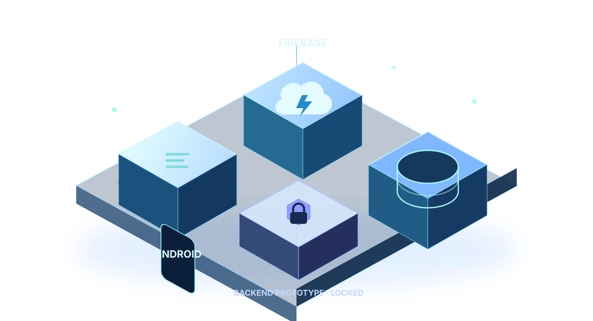

<!--
  CHATIN • README EXPERIENCE
  Transparent 3D vector artwork lives in docs/images/.
  Product screenshots will only be added after real-device verification.
-->

<div align="center">


# CHATIN
### Messenger • Realtime Foundation • Android-first

**Satu ruang komunikasi modern. Cepat, rapi, dan dibangun dengan mengutamakan keandalan serta privasi.**

<p>
  <a href="https://github.com/adebojel/Chatin/actions/workflows/android-debug-apk.yml"></a>
  
  
  
  
</p>

[**Unduh Release**](https://github.com/adebojel/Chatin/releases/tag/v1.0.0) ·
[Build Android](https://github.com/adebojel/Chatin/actions) ·
[Roadmap](docs/PRODUCT_ROADMAP.md) ·
[Keamanan](docs/BACKEND_SECURITY_AUDIT.md) ·
[Laporkan masalah](https://github.com/adebojel/Chatin/issues)

</div>

> [!IMPORTANT]
> **Status proyek: BETA DEVELOPMENT — BELUM SIAP PRODUKSI.** Release GitHub `v1.0.0` sudah dibuat, tetapi ketika dokumentasi ini diperbarui belum memiliki APK pada Assets. APK Debug CI tersedia sebagai artifact sementara; APK Debug bukan APK Release bertanda tangan. Autentikasi Firebase memerlukan konfigurasi project dan uji perangkat. Chat cloud, sinkronisasi offline, push notification, panggilan, media privat, serta E2EE belum dinyatakan siap produksi. Jangan gunakan untuk percakapan rahasia atau data pengguna nyata.

---

## ✦ Jelajahi Chatin

| Bagian | Tujuan |
|---|---|
| [Unduhan & instalasi](#-unduhan-apk-android) | Status APK Debug dan Release |
| [Fitur & status](#-fitur-dan-status-implementasi) | Apa yang sudah ada dan yang belum |
| [Arsitektur](#-arsitektur-sistem) | Komponen Android, Firebase, Room, dan backend |
| [Setup Firebase](#-konfigurasi-firebase) | Menyiapkan autentikasi dan Firestore |
| [Build & pengujian](#-build-dan-pengujian) | Jalur CI melalui GitHub Actions |
| [Roadmap](#-roadmap-pengembangan) | Urutan pekerjaan menuju rilis publik |
| [Keamanan](#-keamanan-dan-privasi) | Batasan yang wajib dipahami |

## ✧ Visi produk

Chatin dikembangkan sebagai aplikasi messenger Android-first dengan pengalaman yang bersih dan responsif. Fokus engineering saat ini adalah fondasi identitas Firebase, penyimpanan lokal Room, alur pesan yang jujur terhadap status pengiriman, dan pipeline build otomatis.

### Prinsip utama

- **Identity first** — Firebase Auth UID menjadi identitas akun kanonis.
- **Offline-aware** — pesan lokal yang belum mendapat acknowledgement tetap berstatus PENDING.
- **Secure by default** — aturan Firestore menolak akses chat sampai model keanggotaan dan layanan tepercaya siap.
- **Honest status** — fitur yang belum selesai tidak ditampilkan sebagai fitur produksi.
- **Mobile-first** — Android native dengan Kotlin dan Jetpack Compose.

## ✧ Arsitektur sistem

<div align="center">
  
  <sub>Ilustrasi arsitektur konseptual. Komponen berstatus prototype atau planned belum menjadi layanan produksi.</sub>
</div>

### Komponen teknologi

| Lapisan | Teknologi | Status |
|---|---|---|
| Android app | Kotlin, Jetpack Compose | Fondasi aplikasi tersedia |
| Identity | Firebase Authentication / Phone OTP | Integrasi SDK tersedia; perlu konfigurasi dan uji perangkat |
| Realtime data | Cloud Firestore | Integrasi dasar; rules dan membership belum siap |
| Local persistence | Room, Coroutines, Flow | Antrean lokal PENDING tersedia; worker retry belum selesai |
| Web client | HTML, CSS, JavaScript | Ada di `public/`; perlu validasi integrasi |
| Backend prototype | Node.js, Express, Socket.IO | Dikunci dari mode production sampai audit ditutup |
| Database backend | PostgreSQL | Skema tersedia; deployment produksi belum disetujui |
| Media | S3-compatible storage | Belum siap untuk data privat/produksi |

## ✧ Fitur dan status implementasi

| Area | Status | Keterangan |
|---|---|---|
| Aplikasi Android |  | Kotlin + Compose |
| Nomor telepon & OTP |  | Firebase Phone Auth; perlu konfigurasi project, SHA fingerprint, kuota SMS, dan uji perangkat |
| Validasi E.164 |  | Format nomor internasional |
| Sesi & logout Firebase |  | Sumber sesi adalah Firebase currentUser |
| Profil Firebase UID |  | UID dan nomor terverifikasi diperiksa pada jalur penulisan profil |
| Pesan Firestore |  | Rules chat sengaja deny-by-default sampai trusted membership/message service tersedia |
| Antrean lokal |  | Room menyimpan pesan PENDING |
| Sinkronisasi offline otomatis |  | Worker retry, backoff, dan idempotency belum selesai |
| Push notification FCM |  | Belum dikonfirmasi aktif |
| Voice/video call |  | WebRTC/signaling belum selesai |
| Media privat |  | Validasi file dan akses privat belum lengkap |
| E2EE |  | Belum ada implementasi protokol E2EE terverifikasi |
| Backend produksi |  | Jangan deploy ke internet atau gunakan data nyata |

## ✧ Unduhan APK Android

### Build Debug untuk pengujian internal

<details open>
<summary><strong>Build terbaru yang terverifikasi</strong></summary>

- Workflow: [Android Debug APK — run #43821972922](https://github.com/adebojel/Chatin/actions/runs/43821972922)
- Commit: `81771e99692b63fc1314cf5274563722cb5d8c5f`
- Status: **success**
- Pemeriksaan: unit tests, kompilasi konfigurasi Release, assemble Debug, inspeksi sertifikat APK, dan upload artifact.
- Artifact: `chatin-debug-apk` (sekitar 29,8 MB)
- Masa simpan artifact pada saat build: sampai **23 November 2026**.

**Cara mengunduh:**
1. Buka [halaman build #43821972922](https://github.com/adebojel/Chatin/actions/runs/43821972922).
2. Pastikan run berstatus **Success**.
3. Gulir ke bagian **Artifacts**.
4. Pilih `chatin-debug-apk`, unduh ZIP, lalu ekstrak.
5. Cari `app-debug.apk` di dalam ZIP.

> Artifact Actions bersifat sementara dan kedaluwarsa sesuai retention. Jika tautan sudah kedaluwarsa, buka [workflow Android Debug](https://github.com/adebojel/Chatin/actions/workflows/android-debug-apk.yml) dan gunakan build terbaru yang sukses.

</details>

### Release APK bertanda tangan

<div align="center">

[](https://github.com/adebojel/Chatin/releases/tag/v1.0.0)

**[Buka Release Chatin v1.0.0](https://github.com/adebojel/Chatin/releases/tag/v1.0.0)**

</div>

Release `v1.0.0` telah tersedia, tetapi **APK belum terunggah ke Assets** pada pemeriksaan terakhir. Saat ini halaman tersebut menampilkan arsip source code. Tautan di atas akan menjadi tempat unduhan APK setelah pipeline Release berhasil.

Workflow rilis: [Build and publish signed Chatin APK](https://github.com/adebojel/Chatin/actions/workflows/build-apk.yml).

Workflow Release membutuhkan GitHub repository secrets berikut:

- `KEYSTORE_BASE64`
- `KEYSTORE_PASSWORD`
- `KEY_ALIAS`
- `KEY_PASSWORD`

Pemilik repository mengatur secret melalui **Settings → Secrets and variables → Actions**. Jangan pernah memasukkan nilai secret ke README, commit, issue, atau chat. Workflow Release dijalankan dari branch `main`, memeriksa unit test, membangun APK Release, memverifikasi signature, menghitung SHA-256, lalu mengunggah APK dan laporan verifikasi ke Release tag yang dipilih.

## ✧ Build dan pengujian

### CI melalui GitHub Actions

- [Android Debug APK workflow](https://github.com/adebojel/Chatin/actions/workflows/android-debug-apk.yml)
- [Signed Release workflow](https://github.com/adebojel/Chatin/actions/workflows/build-apk.yml)
- [Semua workflow runs](https://github.com/adebojel/Chatin/actions)

### Build lokal Android

Persyaratan: JDK 17, Android SDK platform/build tools API 36, dan konfigurasi Firebase yang sesuai.

```bash
git clone https://github.com/adebojel/Chatin.git
cd Chatin
git checkout feat/chatin-core-reliability
./gradlew :app:testDebugUnitTest
./gradlew :app:assembleDebug
```

APK Debug lokal dihasilkan pada:

```text
app/build/outputs/apk/debug/app-debug.apk
```

### Backend prototype

Backend bukan layanan produksi. Untuk pemeriksaan sintaks saja:

```bash
npm install
node --check server.js
```

Jangan menjalankan server pada internet publik atau memasukkan data pengguna nyata. Lihat [audit keamanan backend](docs/BACKEND_SECURITY_AUDIT.md).

## ✧ Konfigurasi Firebase

Package Android:

```text
com.aistudio.chatin.kxqrvz
```

1. Pilih project Firebase yang dimiliki dan dikelola oleh pemilik aplikasi.
2. Daftarkan aplikasi Android dengan package ID di atas.
3. Unduh `google-services.json` untuk aplikasi yang tepat dan letakkan di `app/google-services.json`.
4. Aktifkan **Authentication → Phone**.
5. Atur kebijakan SMS region, kuota, dan nomor uji untuk development.
6. Daftarkan SHA-1 dan SHA-256 untuk sertifikat debug/release yang digunakan.
7. Siapkan Firestore dan validasi rules melalui Firebase Emulator Suite.
8. Uji OTP pada perangkat fisik setelah seluruh konfigurasi benar.

Panduan lengkap: [docs/FIREBASE_SETUP.md](docs/FIREBASE_SETUP.md).

> [!WARNING]
> File `firestore.rules` saat ini merupakan scaffold deny-by-default. Akses `chats` dan `messages` sengaja ditolak sampai trusted chat creation, participant UID membership, dan validasi pesan selesai. Jangan mengganti aturan dengan `allow read, write: if request.auth != null` hanya untuk membuat chat tampak berfungsi.

## ✧ Roadmap pengembangan

- [x] Menguatkan alur Firebase Phone Auth pada branch pengembangan.
- [x] Validasi nomor telepon E.164 dan unit tests.
- [x] Menyimpan identitas chat/pengirim pada antrean lokal Room.
- [x] Menghapus destructive Room migration fallback agar kegagalan migrasi tidak diam-diam menghapus data.
- [x] Menambahkan workflow Android Debug CI dan inspeksi sertifikat APK.
- [x] Menambahkan dokumentasi audit keamanan dan Firebase setup.
- [ ] Menyelesaikan Firebase UID profile migration dan siklus hidup autentikasi.
- [ ] Menyelesaikan trusted chat creation, membership authorization, dan Firestore Emulator tests.
- [ ] Membangun durable offline outbox worker dengan retry/backoff/idempotency.
- [ ] Menyelesaikan FCM token lifecycle dan push notification.
- [ ] Menyelesaikan upload/download media privat dengan validasi tipe, ukuran, dan izin.
- [ ] Mengintegrasikan WebRTC dengan signaling, STUN/TURN, dan pengujian jaringan.
- [ ] Mengintegrasikan protokol E2EE yang diaudit dan diuji interoperabilitasnya.
- [ ] Menutup temuan keamanan backend, WebAuthn, TLS, PostgreSQL, dan otorisasi Socket.IO.
- [ ] Menyelesaikan uji aksesibilitas, performa, stabilitas, dan kompatibilitas perangkat.
- [ ] Menghasilkan APK Release bertanda tangan, memverifikasi SHA-256, dan memasang APK pada Assets Release.
- [ ] Memperbarui tautan unduhan final dan checklist uji pengguna setelah seluruh gate lolos.

Lihat [roadmap engineering terperinci](docs/PRODUCT_ROADMAP.md).

## ✧ Keamanan dan privasi

- Jangan commit `.env`, JWT secret, SMS provider credentials, S3 secret, private signing key, keystore, password keystore, atau Firebase service-account private key.
- Firebase client API key bukan batas otorisasi; gunakan Firestore Security Rules dan App Check.
- Pesan plaintext bukan E2EE. Jangan kirim data rahasia sampai protokol dan audit selesai.
- Jangan deploy backend prototype ke produksi.
- Jangan mempublikasikan screenshot yang memuat nomor telepon, OTP, token, pesan pribadi, atau informasi akun.
- Laporkan kerentanan secara privat kepada pemilik repository.

Dokumen terkait:
- [Backend security audit](docs/BACKEND_SECURITY_AUDIT.md)
- [Firestore rules test plan](docs/FIRESTORE_RULES_TEST_PLAN.md)
- [Firebase setup](docs/FIREBASE_SETUP.md)
- [Open-source integration audit](docs/OPEN_SOURCE_AUDIT.md)

## ✧ Struktur repository

| Path | Fungsi |
|---|---|
| `app/` | Android application |
| `app/src/main/java/` | Kotlin source |
| `app/src/test/` | Unit tests |
| `public/` | Web client |
| `server.js` | Backend prototype |
| `schema.sql` | PostgreSQL schema |
| `gradle/libs.versions.toml` | Dependency version catalog |
| `docs/` | Engineering documentation and visual assets |
| `.github/workflows/` | CI and APK workflows |

## ✧ Kontribusi

Gunakan [GitHub Issues](https://github.com/adebojel/Chatin/issues) untuk bug dan usulan. Sertakan langkah reproduksi, hasil yang diharapkan, hasil aktual, model perangkat, versi Android, dan log yang telah disensor. Jangan menyertakan OTP, password, token, nomor pribadi, atau isi percakapan nyata.

## Lisensi

Periksa file `LICENSE` pada repository. Jika belum tersedia, hak penggunaan ulang dan distribusi belum dinyatakan secara eksplisit.

---

<div align="center">

**CHATIN · BUILD WITH CARE. CONNECT WITH CONFIDENCE.**

[Repository](https://github.com/adebojel/Chatin) ·
[Releases](https://github.com/adebojel/Chatin/releases) ·
[Actions](https://github.com/adebojel/Chatin/actions) ·
[Issues](https://github.com/adebojel/Chatin/issues)

<sub>Dokumentasi mengikuti status branch pengembangan dan harus diperbarui kembali setelah setiap release tervalidasi.</sub>

</div>
